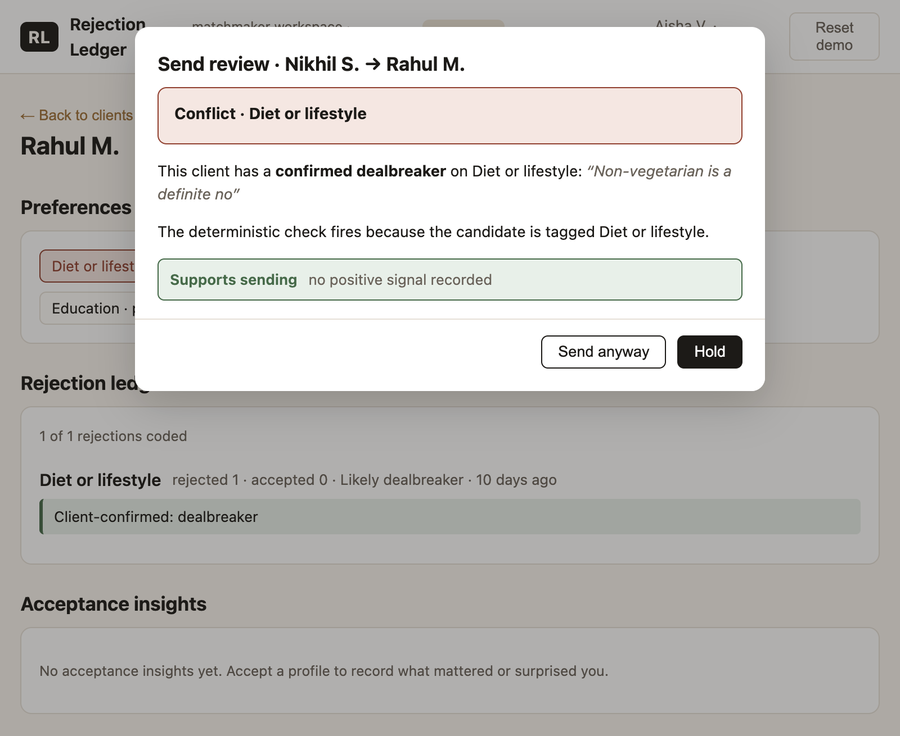
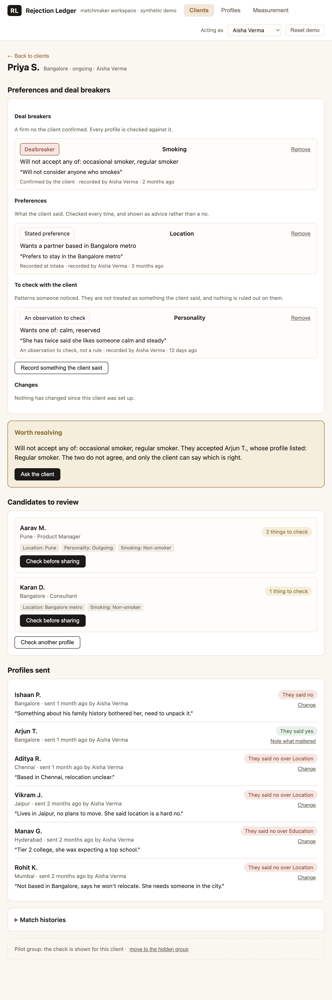

# Rejection Ledger

A matchmaker-side tool built for The Date Crew's product growth assessment. It puts a client's recorded criteria in front of the matchmaker at the moment a profile is about to go out, and it leaves the decision with the matchmaker.

Zero dependencies. Synthetic data only. Runs locally.

## The problem

The brief reports that some profiles are rejected for reasons already stated
in a client's preferences. If that information was available before the
profile was shared, the mismatch may have been preventable.

But the information isn't always complete, current or easy to find. A
preference may be buried in a conversation, rejection feedback may be recorded
only as free text, or a candidate's relevant detail may be unknown.

The problem to test is simple: can a matchmaker catch a known mismatch before
sending a profile, without adding so much work that they stop using the check?

## Why this direction

Storing rejection reasons is only worth doing if it changes a matchmaker's next action. That rules out a client-facing feature that shows clients their own rejection history, and it rules out a dashboard nobody opens. It points at one thing: a check that runs immediately before a profile is shared, while the matchmaker can still do something about it.

So the pre-send check is the product. The rejection ledger is the supporting mechanism that gives it history to work from. Acceptance capture is built but treated as a next step, because there is no evidence that matchmakers fail to capture it today.

## What the prototype does

When a matchmaker is about to share a profile, the tool loads that client's recorded criteria, compares them with the candidate's known attributes, and returns one of five findings:

- **Conflict.** A confirmed dealbreaker matches the candidate's value.
- **Preference mismatch.** The candidate's value does not match a stated or confirmed preference. Advice, not a warning.
- **Contradiction.** A decision the client made disagrees with a criterion they have on file. It is shown with both sides and it decides nothing, because only the client can say which is right.
- **Prior rejection.** The client rejected on this dimension before. A record of what happened, not proof of why.
- **Incomplete.** The client has a criterion here and the candidate's value is unknown. Never reported as "no conflict", because missing information is not agreement.

When there is nothing to compare, the card says that instead of reporting a clean result: no feedback yet, untagged candidate, history present but uncoded, a client whose only record is a pattern someone noticed, or no conflict.

A criterion records a **direction** and a **level of firmness** separately, because they are separate things. "Must be vegetarian" and "must not be vegetarian" are opposite criteria, and a model that stores only a dimension and a value cannot tell them apart. Comparisons are on values, not categories, so a vegetarian candidate does not trip a non-vegetarian dealbreaker. Separate fresh-context AI reviews exposed two gaps in the initial logic: comparing categories instead of actual values, and treating historical behaviour as proof of a preference. I changed the comparison rules and evidence model in response, then added tests for those cases.

Three kinds of evidence are kept apart, because they are not the same thing:

| What is recorded | What it means | How the tool treats it |
| --- | --- | --- |
| A preference confirmed by the client | A rule | Checks every applicable profile against it |
| A preference stated at intake | A stated preference | Surfaces a mismatch as advice |
| A pattern noticed by the matchmaker | A hypothesis | Offers it for clarification; never rules a profile out |
| A previous acceptance or rejection | History | Provides context, but doesn't establish a preference |

A confirmed rule has to be backed by something the client said, either their recorded answer or their own words written down. Without one of those it is an observation, and the write is refused. What the client did, accepted or rejected, is history. It never becomes a rule, and it is never held against them either.

The matchmaker proceeds, holds, or asks the client. Nothing is blocked automatically, no criterion changes without the client's own words, and every override is logged with the check that preceded it.

## How a matchmaker uses it

Everything happens in the interface. No source file needs editing.

1. **Pick who you are.** The header selector picks the matchmaker record you are acting as, and new records are attributed to it.
2. **Create or open a client.** **Add a client** on the Clients view takes a name, a city, the journey stage, and the matchmaker who looks after them.
3. **Record the client's criteria.** On the client, **Record something the client said** takes a dimension, a direction, one or more values, and how sure it is: a pattern you noticed, what they said at intake, what they confirmed, or a no they confirmed. A confirmed rule needs the client's own words, and the write is refused without them. Saving over an existing criterion records what it replaced, and a criterion can be withdrawn without erasing what was once believed.
4. **Choose a profile to review.** On the client, **Check another profile** opens the list of profiles with what is known about each, so nothing is typed twice.
5. **Check before sharing.** The check opens with the one thing that needs a decision, the client's own words beside it, and where the candidate's value came from. Three ways out: **Hold the profile**, **Ask the client**, or share it.
6. **Decide and record.** Sharing past a confirmed deal breaker asks for a reason, and the reason is kept. Rejections are captured from the choices that are relevant to that client and that profile, with an optional note in the client's own words. The client's preferences are never rewritten for them: where their file disagrees with itself, the matchmaker is offered **Ask the client** instead, and the clarification sheet asks one question about one dimension.

## The workflow, in one picture



*Checking a profile before it goes to a client. One finding, the client's own words beside it, and the three ways out. The matchmaker decides.*



*A client's file, opened as a workspace: what they would not accept, what they would prefer, and what has changed.*

## What is implemented

- **The pre-send check.** Five findings, each with the evidence that produced it, the recorded criterion, the candidate's value and where each came from: a conflict against a confirmed deal breaker, a preference mismatch, a contradiction in the client's own file, a prior rejection, and missing information.
- **Three tiers of evidence, kept apart.** Confirmed by the client, recorded at intake, and an observation to check. An observation is a matchmaker's hypothesis. It never fires a finding, never excludes a candidate, and never counts as a confirmed rule.
- **Criteria that keep their history.** A criterion is versioned rather than edited in place, so a profile sent last month is judged against the file as it was then, and a change keeps the version it replaced with the date it was in force.
- **Data entry in the interface.** Clients, candidates, matchmakers and client criteria, all with stable ids, all validated, all with dropdowns backed by the records themselves.
- **Structured rejection capture.** A dimension, a severity, the value that was rejected, and the original wording, with a keyword suggestion for the dimension that a human confirms.
- **A per-client rejection ledger.** History by dimension, contradiction markers, client-confirmed rules, and a change log of every criterion edit, with the old version kept and the date it was in force.
- **Criteria with a direction.** Dimension, direction, values, and firmness, recorded separately. The check compares a known value against a known value in the direction the client set.
- **Client clarification.** A rule is written only from a recorded client answer with the client's own words, never silently. A settled dimension does not silence the dimension forever: a later rejection on it is surfaced again.
- **A measurement model that cannot be improved by using the tool less.** The primary outcome is the proportion of *all* profiles shared in the period that conflicted with a criterion on the client's file at the time, decided by an audit that runs on every share whichever arm the client is on and whether or not the card was opened. The baseline is audited the same way. Adoption is reported beside it, separately, because that is the thing that can move on its own. The full model is in [docs/MEASUREMENT_MODEL.md](docs/MEASUREMENT_MODEL.md).
- **A learning loop, deferred to one click.** An acceptance debrief that captures what a client's yes taught the matchmaker, shown on the client page rather than in the check, and a metric for whether captured insights get consulted.
- **A measurement view for whoever is running the pilot**, in plain language, with the detail kept behind a disclosure.

## What is not implemented

- No AI model call. The core workflow runs with no model and no key. The one place a model would help, proposing a dimension from free text, is stood in by a keyword heuristic that a human confirms.
- No client-facing surface. The only client interaction is a question the matchmaker asks in a normal check-in.
- No ranking, compatibility scoring, or automatic rejection.
- No silent preference writes.
- No sourcing scorecard. The synthetic data cannot support a channel-level comparison, and one was not manufactured.
- No database, no authentication, no email integration, no deployment. The store is a JSON file on disk.

## Run it

```bash
node src/server.js
# or
npm start
```

Open http://localhost:4321

## Test it

```bash
node --test
# or
npm test
```

139 tests cover the send-review rules, the ten decision-logic scenarios, what a criterion means in each direction, the truth rule and its edge cases, the data-entry workflow and its validation, the measurement model and its edge cases, the store, the missing-data handling, and the acceptance-debrief loop. No build step, no install.

## Demo

The script has five sections and twenty numbered steps, listed in full in [docs/DEMO_SCRIPT.md](docs/DEMO_SCRIPT.md). In short:

1. **Open Priya S.** Her file shows what she would not accept, what she would prefer, and a pattern someone noticed that is kept apart from both. It also flags that she confirmed she will not accept a smoker and later accepted one.
2. **Send Aarav M.** The check opens before anything goes out, one finding at a time. **Hold the profile** dismisses it without sending anything; **Share this profile** sends it.
3. **Ask the client.** The sheet asks one question about one dimension and takes the direction, the values, how firm it is and the client's own words. A rule is written from what she said.
4. **Open Rahul M.** and send **Nikhil S.** A confirmed deal breaker, with the client's own words beside it. Sharing anyway asks for a reason.
5. **Open Neha K.** and send **Varun J.** The check says his position on children is not recorded, which is neither a match nor a mismatch.
6. **Open How it's going.** What has happened so far, in plain language, with the detail behind a disclosure.

Reset the demo before each section.

The screenshots are in [screenshots/](screenshots/).

## Stack

Node 22, `node:http` server, `node:test` test runner, plain HTML, CSS and JavaScript. No npm dependencies, no database, no authentication, no API key, no external service. The development store is a JSON file under `_store/` (gitignored), written only so records survive a restart.

## Repo layout

```
src/
  server.js            local HTTP server, action API and the ad-hoc check endpoint
  lib/
    dimensions.js      the 13-dimension vocabulary, the values on each, and the question to ask
    rules.js           deterministic send-review logic, the criterion tiers and the contradiction rule
    metrics.js         the send-time conflict rate, the diagnostics and the learning-loop metric
    store.js           the synthetic seed, the in-memory store, the criteria and the point-in-time audit
    suggest.js         keyword heuristic standing in for the model
    bootstrap.js       assembles the payload the UI renders
  public/              index.html, app.css, app.js
test/                  the test suite
docs/                  the supporting documents, indexed in docs/README.md
phase1/                the preserved Phase 1 research and decisions
```

## Where things are

- The assessment of record is [ASSIGNMENT_SUBMISSION.md](ASSIGNMENT_SUBMISSION.md). It is the only document that is the answer to the brief.
- The measurement model, in full, is in [docs/MEASUREMENT_MODEL.md](docs/MEASUREMENT_MODEL.md).
- The reasoning is in [docs/PRODUCT_THINKING.md](docs/PRODUCT_THINKING.md), the decisions and their trade-offs in [docs/PRODUCT_DECISIONS.md](docs/PRODUCT_DECISIONS.md), and the full document index in [docs/README.md](docs/README.md).
- The words the product uses, where each came from, and what it replaced, are in [docs/TERMINOLOGY.md](docs/TERMINOLOGY.md). No phrase goes in the interface that the company has not been recorded as using.

## Data

Every name, city, profession and note is invented. No real client, matchmaker or contact detail appears anywhere. The prototype is labelled synthetic in the UI, in the API payload and in the seed.

## What remains to be validated

Nothing here has been tested with a real matchmaker, and no real client data has been seen. The specific open questions and the cheapest way to answer them are in [docs/VALIDATION_PLAN.md](docs/VALIDATION_PLAN.md). The short version: whether the 35% figure and its denominator are as reported, whether a matchmaker will consult the check at the point of sending, and whether the criteria on file are accurate enough to compare against.

The measurement model is a proposed pilot design, not a demonstrated result. The numbers in the prototype come from synthetic data, and two weeks of a pilot could show whether the workflow is used and the rate moves. It could not show a business effect.
